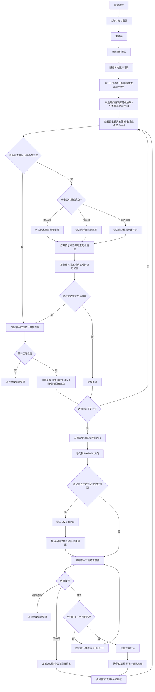

# 上班不摸鱼核心玩法与系统策划案

## 输入变量

```text
游戏名称 = "上班不摸鱼"
游戏品类 = "竖屏轻度时间管理与办公室潜行生存"
核心题材 = "都市打工人从9点开始完成各种摸鱼小游戏，拖到基础下班时间18点半；被抓会延长下班时间，直到达到当前下班时间后离开，第二天继续摸鱼"
屏幕方向 = "竖屏"
发布平台 = "移动端"
视觉表现 = "2D 等距视角手账漫画风与轻喜剧办公室"
运行方式 = "单机游戏，本地存档"
```

## 一 核心玩法与操作机制

### 1 基础操作框架

游戏采用竖屏单指操作，核心动作只有“点击地点、进入、确认”三步。地图使用固定镜头，不支持放大或缩小。玩家不需要完成工作任务，所有操作都围绕选择摸鱼点、完成小游戏和安全离开公司展开。
 
| 操作 | 玩家动作 | 系统反馈 |
| --- | --- | --- |
| 点击摸鱼点 | 点击茶水间、洗手间或消防楼梯的互动入口 | 主角自动移动到对应地点，到达后显示【开始摸鱼】按钮 |
| 点击【开始摸鱼】 | 确认进入小游戏 | 地图操作暂时锁定，打开对应的独立小游戏 |
| 完成小游戏 | 接收独立小游戏返回的通关结果 | 通关后读取时间奖励，结算快进时间和冷却，并回到原地图 |
| 点击大门 | 达到当前下班时间后点击大门交互点 | 主角移动到大门并打开唯一的“下班结算”弹窗，显示结算信息和三个按钮 |

### 2 连续工作日核心循环

玩家从第 1 天上午 09:00 开始，目标不是完成工作，而是通过 3 个摸鱼点的小游戏把时间拖到当天实际下班时间，并在大门完成下班方式选择。基础下班时间为 18:30；如果当天被老板抓到，实际下班时间会按当前天数档位增加固定加班时长。
普通状态下，现实 1 秒推进游戏 1 分钟；小游戏通关后按配置额外推进时间，因此完成小游戏是主要的时间管理手段。
若被老板抓到，立即按当前天数档位扣除草料，并将当天实际下班时间延长到“基础下班时间 + 当前档位固定加班时长”。同一天多次被抓时，加班时长不叠加。

草料规则：第 1 天 09:00 进入游戏时获得 100 草料；每个工作日完成下班结算后获得 100 草料；大门阶段选择【打工】并完成广告或触发配置兜底时，每天最多获得 1 次 50 草料。被老板抓到时按当前天数档位扣除草料，十档扣除值为 `60 / 60 / 70 / 70 / 80 / 80 / 90 / 90 / 100 / 100`。如果当前草料不足以支付本次扣款，立即进入【游戏结束界面】。

1. **09:00 开始上班**：基础下班时间为 18:30，玩家从工位开始摸鱼。
2. **09:00-当前实际下班时间摸鱼阶段**：点击任意摸鱼点，自动移动后进入小游戏；老板全程保持检测。被抓时中断当前小游戏，按当前天数档位扣除草料，并将当天实际下班时间设为基础下班时间加固定加班时长，玩家仍留在工作状态继续摸鱼。
3. **达到当前实际下班时间后进入大门阶段**：关闭 3 个摸鱼点，只开放大门。玩家点击大门后自动移动并打开唯一的“下班结算”弹窗，弹窗同时显示当日结算信息和【打工】【结束游戏】【下一天】三个按钮。点击【打工】完成广告流程后获得 50 草料并自动进入次日 09:00；点击【下一天】进入次日 09:00；点击【结束游戏】进入游戏结束界面。
4. **实际下班时间规则**：当天未被抓时，实际下班时间为 18:30；当天被抓后，实际下班时间为 18:30 加当前天数档位的固定加班时长。加班时长只在当天有效，进入下一天后清零。

### 3 地图与摸鱼点

| 地点 ID | 名称 | 类型 | 默认绑定小游戏 ID |
| --- | --- | --- | --- |
| MAP001 | 工位 | 起始地点 | 无 |
| MAP002 | 老板办公室 | 地点 | 无 |
| MAP003 | 茶水间 | 摸鱼点 | MG001（随机模式可覆盖） |
| MAP004 | 洗手间 | 摸鱼点 | MG002（随机模式可覆盖） |
| MAP005 | 消防楼梯 | 摸鱼点 | MG003（随机模式可覆盖） |
| MAP006 | 大门 | 离开地点 | 无 |

只有绑定小游戏的地点才是摸鱼点；MAP006 只用于下班离开。
工位和老板办公室不提供直接摸鱼入口，茶水间、洗手间、消防楼梯在每天 09:00 开始工作日时，从游戏库随机获得 3 个不重复小游戏 ID，并分别分配给 3 个摸鱼点。
玩家每次完成摸鱼小游戏都获得一次时间快进结算。奖励数值以对应小游戏文档和配置为准。

#### 3.1 摸鱼点统一交互协议

1. 玩家点击摸鱼点，角色自动移动到互动点。
2. 到达互动点后显示【开始摸鱼】确认按钮，确认后锁定地图移动并进入独立小游戏场景。
3. 小游戏成功、失败、被老板打断或主动退出，都必须返回原地图的同一摸鱼点。
4. 当前版本不再对未到下班时间的大门点击显示“未到下班时间”飘字；大门交互按当前阶段处理。达到实际下班时间后，所有摸鱼点显示【下班后不可用】，大门进入正式离开流程。点击大门后打开下班方式弹窗，必须完成弹窗选择后才能结束当天流程。

#### 3.2 时间快进奖励

- 小游戏奖励单位为秒，字段名为 `time_reward_seconds`。
- 奖励只在小游戏结算时读取，不在摸鱼点或主文档重复配置。
- 成功、部分成功和失败的奖励档位由对应小游戏文档维护；主动退出不发放时间奖励。
- 奖励只能结算一次，且不能让游戏时间超过当前下班时间。

### 4 老板与抓捕规则

老板视野为全方位 360° 检测区域，会被墙、磨砂隔断和关闭的门阻挡。

老板在工作时间持续巡逻，进入小游戏期间也不会停止检测。非巡查状态下，游戏左上角显示警报条，用于提示老板接近当前摸鱼点；警报条充满时判定被抓。

老板进入巡查状态后，玩家必须停留在 MAP001 的工位安全点；玩家位于老板办公室、任一摸鱼点或小游戏场景时，直接判定为摸鱼并触发抓捕结算，不再等待视野条充满。

被抓后立即中断当前小游戏，不发放本次通关奖励，玩家保持当前地点并结算一次当前档位的扣草料。当天固定加班时长只设置一次，不因多次被抓而叠加；进入下一天后扣除统计和加班状态重置。

老板巡逻按天数分为十档：第 1 档为第 1-3 天，第 2 档为第 4-7 天，第 3 档为第 8-14 天，第 4 档为第 15-21 天，第 5 档为第 22-30 天，第 6 档为第 31-44 天，第 7 档为第 45-59 天，第 8 档为第 60-74 天，第 9 档为第 75-99 天，第 10 档从第 100 天开始。

后续巡逻间隔按天数逐档缩短，但适配 5 分钟以上的摸鱼小游戏：第 1-3 天为 420-600 秒，第 4-7 天为 390-570 秒，第 8-14 天为 360-540 秒，第 15-21 天为 330-510 秒，第 22-44 天为 300-390 秒，第 45-99 天为 300-360 秒，第 100 天以后为 300-330 秒。所有后续巡逻间隔最低为 300 秒，前期最高可等待 10 分钟。

### 5 游戏库与小游戏 ID 分配

所有可被随机到的小游戏必须先加入 `game_library.games`，并将 `enabled` 配置为 `true`。未进入游戏库或 `enabled=false` 的小游戏不能被随机到。

| 模式 | 规则 | 小游戏 ID 来源 |
| --- | --- | --- |
| 随机模式 | 每天 09:00 开始工作日时，从游戏库随机抽取 3 个不重复小游戏 ID，并按固定顺序分配给 3 个摸鱼点；第二天重新抽取 | `game_library.games` 中 `enabled=true` 的 ID |

游戏只保留随机模式，不提供固定模式或周几绑定。

进入工作日时从游戏库抽取 3 个不重复 ID，生成 `RunState.active_spot_minigames` 并固定到当天；第二天 09:00 清空并重新抽取。完成小游戏后只接收独立小游戏文档返回的通关结果，再按其 `level_index` 读取 `time_reward_seconds`，主文档不写小游戏玩法规则。

例如项目中共有 10 个小游戏，但 `game_library.games` 只有 5 个条目的 `enabled=true`，当天只会从这 5 个小游戏中随机抽取 3 个；进入第二天后，再从这 5 个小游戏中重新随机抽取 3 个。


## 二 视听表现与美术风格

### 1 整体基调

画面采用 2D 等距手账漫画风。6 个地点使用不同贴纸页：工位使用灰蓝格纸，老板办公室使用深灰木纹，茶水间偏薄荷绿，洗手间偏浅青，消防楼梯使用冷灰金属，大门使用夕阳橙和门禁灯。角色统一采用 2.5 头身比例。09:00 光线偏冷，工作时间逐渐转为明亮暖黄，18:30 后出现橙紫晚霞和拉长阴影。

主色为纸张米白 #F4EBD8、工位灰蓝 #7B91A7、薄荷绿 #70BFA1、下班夕阳橙 #F29D49。警示红 #D9544D 只用于老板视野、检测条和失败原因。

### 2 动画规范

- 点击地点：目标圆环在 0.15s 内扩散并淡出，角色自动移动到已选地点。
- 地点切换：Portal 交互后播放 0.25s 纸页翻动或房门闭合动画；目标地点加载完成后 0.2s 淡入。
- 人物转向：0.1s；起步 0.12s；移动停止使用 0.08s 缓出。
- 时钟正常推进：分钟数字每秒翻页；小游戏结算时间奖励时播放快进反馈。
- 摸鱼完成：显示通用成功反馈和时间快进提示，0.4s 后返回地图。
- 被抓：老板头顶红色感叹号 0.15s 弹出，画面轻震 0.2s；读取当前天数档位的扣草料和固定加班时长。草料足够时立即扣除当前档位草料，显示【摸鱼值 +20】【草料 -X】【下班时间延长 +X 分钟】并保持在原地图地点；草料不足时不再继续当天流程，直接进入【游戏结束界面】。同一天再次被抓不增加加班时长。
- 达到当前下班时间：时钟盖下【下班】印章 0.4s，环境灯在 0.6s 内变为夕阳色，出口高亮。

### 3 音频规范

- 主界面 BGM：72 BPM 的轻松 lo-fi 键盘、订书机节拍与下班广播采样。
- 上班阶段 BGM：轻柔键盘和时钟节拍；摸鱼时临时增加快进磁带音，不改变音高。
- 工作阶段 BGM：保持键盘和时钟节拍，小游戏成功时加入短促快进音效。
- 达到当前下班时间的离开阶段 BGM：保留原旋律，加入门禁滴声和下班广播采样，避免突变成恐怖风格。
- 六地点环境声：工位使用空调与键盘声，老板办公室使用文件翻动声，茶水间使用饮水机与冰箱声，洗手间使用排风声，消防楼梯使用脚步回声，大门使用门禁滴声和街道环境声。
- 小游戏成功使用纸杯碰桌和柔和正反馈音；失败使用短促提示音。
- 点击、路径失败、行为开始、行为完成、被发现、出口打开均使用可区分的短音效。

## 三 核心界面可视化与全景交互逻辑

### 1 界面层级总览

| 界面 | 类型 | 父级 |
| --- | --- | --- |
| 主界面 | 独立全屏 | 无 |
| 工位摸鱼界面 | 独立全屏 | 主界面 |
| 暂停界面 | 覆盖型弹窗 | 工位摸鱼界面 |
| 设置界面 | 覆盖型弹窗 | 主界面或暂停界面 |
| 下班结算弹窗 | 覆盖型弹窗 | 工位摸鱼界面 |
| 游戏结束界面 | 覆盖型弹窗 | 工位摸鱼界面 |

### 2 主界面

**界面定义：**独立全屏游戏外枢纽。

**线框图：**

```text
+--------------------------------------+
|[设置]        上班不摸鱼               |
|                                      |
|          [工位与公司大门主视觉]        |
|                                      |
|              最高记录                 |
|                                      |
|           坚持 7天  草料 100        |
|                                      |
|               [开始上班]              |
+--------------------------------------+
```

**视口占比：**顶部标题与设置 14%，主视觉 48%，最高记录 16%，模式按钮与安全区 22%。

**层级：**背景 Z0，角色 Z10，最高记录 Z20，模式按钮 Z30，Toast Z50。无遮罩。

**刷新规则：**

| 组件 | 数据源 | 刷新 | 边界与默认 |
| --- | --- | --- | --- |
| 坚持天数 | SurvivalProfile.best_survived_days | OnEnable、OnRunEnded | 显示历史最长坚持天数；默认 0 天 |
| 草料 | PlayerProfile.feed | OnEnable、OnFeedChanged、OnRunEnded | 显示当前草料；默认 0；最低为 0 |
| 模式按钮 | game_modes.mode_id | OnEnable | 固定显示【随机模式】 |

**交互事件：**

| 控件 | 输入 | 校验 | 逻辑与反馈 |
| --- | --- | --- | --- |
| 随机模式 | Tap | 配置加载完成且游戏库至少有 3 个启用游戏 | 从游戏库随机抽取 3 个不重复 ID 并分配给当天 3 个摸鱼点，进入工位摸鱼界面 |
| 设置 | Tap | 无 | 打开设置弹窗 |

**高保真界面中文生成提示词：**

**图片一：完整 UI 效果图 Prompt**

```text
Create a high-fidelity commercial vertical 9:16 main menu UI for the office slacking simulator "上班不摸鱼". Deeply depict an urban office workstation connected to the company gate as the main visual theme, using 2D scrapbook manga styling, hand-cut paper edges, paper ivory, workstation blue-gray, mint green accents, warm afternoon sunlight, soft shadows, and detailed office materials. Follow this exact wireframe layout without rearranging elements: in the top row, place one compact settings button labeled "设置" at the far left and place the Chinese title "上班不摸鱼" centered horizontally; leave the rest of the top row uncluttered. Place "工位与公司大门主视觉" as the large central visual focus. Directly below the main visual, place a centered label "最高记录" on its own line. On the next line, place the centered record values "坚持 7天  草料 100". At the bottom center, place one large button labeled "开始上班". Do not move the settings button, title, record label, record values, or start button from these positions. Use office-paper materials for every panel, button, icon, border, shadow, and highlight. All specified UI text must be rendered in Simplified Chinese exactly and must not be translated or replaced.

```

**图片二：场景纯净底图 Prompt**

```text
Create only the clean vertical 9:16 background for the same main menu: an urban office workstation connected to the company gate. Remove the top-left "设置" button, centered "上班不摸鱼" title, the "最高记录" label, the "坚持 7天  草料 100" record line, the bottom "开始上班" button, and every other UI element. Reconstruct all covered regions with continuous paper, furniture, windows, lighting, shadows, and office textures. Preserve the central workstation-and-gate focal point, the original camera, and the exact composition. Leave no UI residue, text, placeholder marks, or ghosting.
```

**图片三：原位坐标 UI 切图 Prompt**

```text
Create only the main-menu UI asset cutout on a pure white or transparent background. Extract the top-left button "设置", the centered title "上班不摸鱼", the centered record label "最高记录", the next-line empty record-value text box with no text or numbers inside, and the bottom-centered button "开始上班". Preserve their exact original absolute coordinates, line breaks, and scale from the complete UI image. Keep independent artistic lettering, remove all 0-9 numeric glyph slices, preserve the original paper material, lighting, and hard silhouette edges, and add separate black bounding frames around the settings group, title group, record-label group, empty record-value text-box group, and bottom button group. Do not merge unrelated assets or arbitrarily split words or letters.
```

### 3 工位摸鱼界面

**界面定义：**独立全屏连续工作日玩法界面，6 个地点共用同一 HUD 与镜头控制，由主界面模式按钮直接进入。

**线框图：**

```text
+--------------------------------------+
| [暂停]      第3天  11:20: 55          |
|                                      |
| 下班时间：18：30：30      草料 100    |
|                                      |
|        老板下一次巡逻：9000秒          |
|                                      |
|  ┌────────────  地图  ─────────────┐ |
|  | [茶水间]                        |  |
|  |                                |  |
|  |                  [老板办公室]   |   |
|  |                        老板     |  |
|  |                                |  |
|  | [工位]                          |  |
|  |  玩家                           |   |
|  |                                |  |
|  |                        [洗手间] |  |
|  |                                |  |
|  | [消防楼梯]                      |  |  
|  |            [大门]               |   |    
|  └────────────────────────────────┘  |
+--------------------------------------+
```

**视口占比：**顶部状态栏 18%，工位及其他地点场景 82%，不设置独立底部提示区。

**层级：**地面 Z0，设施 Z5，人物与老板 Z10，老板视野 Z15，HUD Z20，行为确认 Z30，Toast Z50。

**刷新规则：**

| 组件 | 数据源 | 刷新 | 插值与边界 |
| --- | --- | --- | --- |
| 时钟 | RunState.game_minutes | 每 0.1s | 正常推进；小游戏结算后按时间奖励快进；达到当前下班时间盖章 |
| 阶段文本 | RunState.phase | OnPhaseChanged | WORK、GATE、OVERTIME 分别显示摸鱼中、摸鱼结束去大门、加班中 |
| 工作日文本 | RunState.day_index | OnDayStarted、OnDayEnded | 显示第 X 天；游戏结束后显示总天数 |
| 草料 | PlayerProfile.feed | OnFeedChanged、OnDayEnded、OnCaught | 显示当前草料，最低为 0 |
| 加班文本 | RunState.overtime_end_game_minutes | OnPhaseChanged、每 0.1s | OVERTIME 显示当天实际下班时间；默认隐藏 |
| 当前地图 | RunState.current_map_id、maps | OnMapChanged | 显示地图中文名；未加载时显示【切换中】 |
| 摸鱼设施 | RunState.active_spot_minigames、RunState.current_map_id | OnMapChanged、OnPhaseChanged | 在地图上显示当天分配的三个摸鱼点入口，达到当前下班时间后隐藏并高亮大门 |
| 下次巡逻 | BossState.next_patrol_seconds | 每秒、OnBossScheduleChanged | 显示下一次老板巡逻剩余时间；无计划时显示“待命” |
| 老板检测 | Detection.current_seconds | 每帧、OnDetectionChanged | 仅在老板接近或发现玩家时临时显示，离开后隐藏 |
| 大门状态 | RunState.gate_state | OnPhaseChanged、OnGateChanged | 当前下班时间前锁定且不可点击；达到后解锁并显示【离开公司】 |

**交互事件：**

| 控件 | 输入 | 前置校验 | 逻辑与反馈 |
| --- | --- | --- | --- |
| 地图画面 | Tap | 点击地点或 Portal 入口 | 只响应可交互地点，不响应普通地面点击 |
| 摸鱼设施 | Tap | 对应玩法未冷却、设施空闲 | 人物移动到互动点并打开玩法确认 |
| 地图 Portal | Tap | 当前阶段允许、目标地图配置有效 | 人物移动至入口，保存当前地图状态并切换目标地图；大门是否开放由当天实际下班时间和当前阶段统一判断 |
| 行为确认 | Tap | 人物已到达、阶段为 WORK、当天已完成游戏分配 | 打开当前摸鱼点绑定的小游戏，锁定地图移动并进入对应小游戏 |
| 摸鱼小游戏 | Tap、Hold | 玩法配置有效 | 接收通关结果；通关后发放配置中的时间快进奖励 |
| 取消 | Tap | 行为尚未开始 | 关闭确认，不改变时间 |
| 大门 | Tap | 当前地图存在大门交互区域 | 主角移动到大门后打开唯一的【下班结算】弹窗；弹窗处理“打工”“结束游戏”“下一天”，不直接结束当天流程 |
| 结束游戏 | Tap | 暂停界面确认 | 清空当前进度并返回主界面 |
| 暂停 | Tap | 非转场动画 | 保存状态并打开暂停弹窗 |

**高保真界面中文生成提示词：**

**图片一：完整 UI 效果图 Prompt**

```text
Create a high-fidelity commercial vertical 9:16 gameplay UI for the office slacking simulator "上班不摸鱼". Deeply depict one fixed-camera workstation scene in a 2D scrapbook manga office: a relaxed employee in a cubicle, desk, monitor, laptop, papers, coffee, plants, soft office partitions, a city window, warm sunset light, blue-gray furniture, ivory paper textures, and mint green accents. At the top of the screen place the pause control on the left, the day and current time in the center, and the leaving-time status with the exact Chinese text "下班时间" and a green progress bar in the upper status area; show "草料 100" as the resource text. In the upper-right corner place a small floating status card with a fish icon and the exact Chinese text "摸鱼进行中". Keep the workstation and character as the large central focal point. At the bottom center place three horizontally aligned functional buttons labeled "上班", "摸鱼", and "下班". Use clear spatial hierarchy and unify every UI panel, button, icon, border, shadow, and highlight with the office-paper material language. All specified UI text must be rendered in Simplified Chinese exactly and must not be translated or replaced.

```

**图片二：场景纯净底图 Prompt**

```text
Create only the clean fixed-camera workstation background for the same gameplay screen. Remove the pause control, top status bar, day and time, "下班时间" progress bar, "草料 100" text, upper-right "摸鱼进行中" card, and bottom buttons. Reconstruct every covered region with pixel-accurate cubicle, desk, monitor, laptop, papers, coffee, plants, office partitions, city window, warm sunset light, and shadows. Preserve the exact vertical 9:16 composition and leave no UI residue, text, ghosting, or placeholder marks.
```

**图片三：原位坐标 UI 切图 Prompt**

```text
Create only the UI asset cutout for the same gameplay screen on a pure white or transparent background. Extract the pause control, day/time group, "下班时间" progress bar, "草料 100" resource group, upper-right "摸鱼进行中" status card, and bottom "上班", "摸鱼", and "下班" buttons at their exact original absolute coordinates from the complete UI image. Preserve independent artistic lettering, remove all 0-9 numeric glyph slices, retain original materials and lighting, use hard pixel-clean edges with no anti-aliased blur, color spill, or translucent fringe, and add separate black bounding frames around the top status group, upper-right status card, and bottom button group. Do not merge unrelated assets or arbitrarily split words or letters.
```

### 4 下班结算弹窗

**界面定义：**覆盖型弹窗，父级为工位摸鱼界面；玩家抵达 MAP006 大门后打开。弹窗只有一个固定内容和三个操作按钮，不切换第二个界面，也不创建新的结算弹窗。

```text
+--------------------------------------+
|............. 黑色遮罩 60% ...........|
|       +----------------------+       |
|       |       第3天结束       |       |
|       |      今日工时 120秒    |       |
|       |      摸鱼工时 120秒    |       |
|       |      当前草料 100      |       |
|       |                        |       |
|       | [结束游戏]   [下一天]   |       |
|       |                        |       |
|       |    [兼职打工]↗看广告    |       |
|       |  兼职打工可获得额外50草料 |       |
|       +----------------------+       |
+--------------------------------------+
```

**流程规则：**弹窗打开后始终保留当天结算信息和三个按钮。点击【兼职打工】后拉起激励广告；完整观看或走配置兜底后增加 50 草料，结算当天并自动进入次日 09:00。广告关闭且未触发兜底时不增加草料，弹窗保持原状态。点击【下一天】完成当天结算并进入次日 09:00；点击【结束游戏】进入游戏结束界面。

**视口占比：**遮罩覆盖 100%，弹窗宽 80%、高 58%；标题与结算信息 58%，【兼职打工】按钮 16%，【结束游戏】【下一天】按钮 18%，留白 8%。

**层级：**场景 Z0，遮罩 Z35，下班结算弹窗 Z40，面板装饰与结果文字 Z45，按钮与广告标识 Z46，Toast/广告加载提示 Z50。点击遮罩不关闭。

**刷新规则：**打开时读取并锁定 `DaySettlement.day_index`、`fast_forward_seconds`、`feed_reward` 和 `PlayerProfile.feed`；广告成功返回时只刷新 `PlayerProfile.feed` 和当前草料文案，其他当日结算信息不变。

**交互事件：**

| 控件 | 输入 | 前置校验 | 逻辑与反馈 |
| --- | --- | --- | --- |
| 兼职打工（右上角带【看广告】标识） | Tap | `work_reward_used=false`、广告服务可用 | 拉起激励广告；完整观看或走配置兜底后获得 `gate_work_reward_feed`（50）草料，标记今日已使用并自动进入次日 |
| 打工（已使用） | Tap | `work_reward_used=true` | 按钮置灰并提示【今日已打工】；不重复发放草料 |
| 广告关闭/失败 | Close、Error | 广告未完整观看且未触发兜底 | 不发草料、不标记已使用，返回同一个弹窗 |
| 下一天 | Tap | 结算数据写入完成 | 发放 `daily_completion_feed_reward`（100）草料，保存当日结果，关闭弹窗并进入次日 09:00 |
| 结束游戏 | Tap | 结算数据写入完成 | 关闭弹窗并进入游戏结束界面 |
| 遮罩 | Tap | 无 | 不关闭弹窗 |

**高保真界面中文生成提示词：**

**图片一：完整 UI 效果图 Prompt**

```text
Create a high-fidelity commercial vertical 9:16 single daily-settlement modal UI for the office slacking simulator "上班不摸鱼". Use a fixed evening company-gate background with warm orange street light, access-control glow, office-paper textures, metal gate details, long shadows, and a restrained scrapbook manga palette. Cover the full screen with one 60% black overlay and place one single centered paper-and-metal modal panel. Follow this exact wireframe structure without rearranging elements: at the top of the panel place the Chinese title "第3天结束"; below it stack the three result rows "今日工时 120秒", "摸鱼工时 120秒", and "当前草料 100". In the lower action area, place exactly two horizontally aligned buttons on the same row, "结束游戏" on the left and "下一天" on the right. Directly below that row, place one centered button labeled "兼职打工". Attach one small, clearly readable badge labeled "看广告" to the upper-right corner of the "兼职打工" button. Directly below this button place the exact note "兼职打工可获得额外50草料". Keep the three action areas visually separate and do not turn the note into a fourth button. Do not add "打工", "下一关", "立即回家", a second popup, bottom navigation, or any other unlisted UI. All specified UI text must be rendered in Simplified Chinese exactly and must not be translated or replaced.
```

**图片二：场景纯净底图 Prompt**

```text
Create only the clean fixed evening company-gate background for the single daily-settlement modal. Remove the 60% black overlay and the centered modal panel, including the title "第3天结束", result rows "今日工时 120秒", "摸鱼工时 120秒", "当前草料 100", the two-button row "结束游戏" and "下一天", the lower "兼职打工" button, its "看广告" badge, and the note "兼职打工可获得额外50草料". Reconstruct every covered region with continuous gate materials, warm street light, access-control glow, metal details, long shadows, and paper textures. Preserve the vertical 9:16 composition and leave no UI residue, text, ghosting, or placeholder marks.
```

**图片三：原位坐标 UI 切图 Prompt**

```text
Create only the single daily-settlement modal UI asset cutout on a pure white or transparent background. Extract one 60% overlay treatment, one centered paper-and-metal modal panel, the title "第3天结束", result rows "今日工时 120秒", "摸鱼工时 120秒", "当前草料 100", the two horizontally aligned buttons "结束游戏" and "下一天", the centered lower button "兼职打工", the small badge "看广告" attached to the upper-right corner of "兼职打工", and the note "兼职打工可获得额外50草料" at their exact original absolute coordinates. Preserve the exact hierarchy: the two main buttons share one row, the part-time button is below them, and the note is below the part-time button. Do not extract or invent "打工", "下一关", "立即回家", a second popup, or any fourth action. Preserve materials and lighting, remove all 0-9 numeric glyph slices, use hard pixel-clean edges with no anti-aliased blur, color spill, or translucent fringe, and add separate black bounding frames around the overlay, panel, result group, button row, part-time button, badge, and advertising note. Do not merge unrelated assets or arbitrarily split words or letters.
```

### 5 暂停界面

**界面定义：**覆盖型弹窗，父级为工位摸鱼界面。

**线框图：**

```text
+--------------------------------------+
|............. 黑色遮罩 65% ...........|
|       +----------------------+       |
|       |         暂停         |       |
|       |                      |       |
|       |      第3天 11:20     |       |
|       |                      |       |
|       |      [返回主界面]     |       |
|       |                      |       |
|       |       [继续游戏]      |       |
|       +----------------------+       |
+--------------------------------------+
```

**视口占比：**遮罩覆盖 100%，弹窗宽 72%、高 46%；弹窗内标题与状态 30%，操作按钮 30%，上下留白 40%。

**层级：**场景 Z0，黑色遮罩 Z35，暂停弹窗 Z40，按钮与文字 Z45，Toast Z50。点击遮罩不关闭。

**刷新规则：**打开时读取 `RunState.day_index`、`RunState.game_minutes` 和当前存档状态；时间显示固定到打开瞬间，继续游戏后恢复实时刷新；返回主界面前保存一次本地存档。

**交互事件：**

| 控件 | 输入 | 前置校验 | 逻辑与反馈 |
| --- | --- | --- | --- |
| 继续游戏 | Tap | 非存档写入中 | 关闭弹窗，0.2s 后恢复游戏时钟和老板检测 |
| 返回主界面 | Tap | 无 | 弹出放弃确认；确认后保存并返回主界面，取消则留在暂停界面 |
| 遮罩 | Tap | 无 | 不关闭弹窗 |

**高保真界面中文生成提示词：**

**图片一：完整 UI 效果图 Prompt**

```text
Create a high-fidelity commercial vertical 9:16 pause modal UI for the office slacking simulator "上班不摸鱼". Use the current fixed-camera office scene as a dimmed background with a 65% black overlay, paper scrapbook manga materials, soft office lighting, and a quiet frozen-time mood. Place one centered compact paper dialog. At the top of the dialog place the Chinese title "暂停", below it place the current status "第3天 11:20", and stack two large vertically aligned buttons: "返回主界面" first and "继续游戏" second. Use clear touch targets, generous whitespace, strong contrast, and an office-paper border. All specified UI text must be rendered in Simplified Chinese exactly and must not be translated or replaced.

```

**图片二：场景纯净底图 Prompt**

```text
Create only the clean frozen office background for the same pause screen. Remove the 65% black overlay, pause dialog, title, status text, and both buttons. Reconstruct every covered region with continuous office furniture, paper materials, lighting, shadows, and textures. Preserve the fixed-camera vertical 9:16 composition and quiet frozen-time mood. Leave no UI residue, text, ghosting, or placeholder marks.
```

**图片三：原位坐标 UI 切图 Prompt**

```text
Create only the pause UI asset cutout on a pure white or transparent background. Extract the 65% overlay, centered dialog, title "暂停", status "第3天 11:20", buttons "返回主界面" and "继续游戏" at their exact original absolute coordinates from the complete UI image. Preserve independent artistic lettering, remove all 0-9 numeric glyph slices, retain original materials and lighting, use hard pixel-clean edges with no anti-aliased blur, color spill, or translucent fringe, and add separate black bounding frames around the overlay, dialog, status group, and button group. Do not merge unrelated assets or arbitrarily split words or letters.
```

### 6 设置界面

**界面定义：**覆盖型弹窗，父级为主界面或暂停界面。

**线框图：**

```text
+--------------------------------------+
|............. 黑色遮罩 65% ...........|
|       +----------------------+       |
|       |         设置         |       |
|       |                      |       |
|       | 音乐       [进度条]   |       |
|       |                      |       |
|       | 音效       [进度条]   |       |
|       |                      |       |
|       |        [关闭]        |       |
|       +----------------------+       |
+--------------------------------------+
```

**视口占比：**遮罩覆盖 100%，弹窗宽 72%、高 42%；标题 16%，开关列表 64%，关闭按钮与留白 20%。

**层级：**父界面 Z0，黑色遮罩 Z35，设置弹窗 Z40，控件 Z45，Toast Z50。点击遮罩不关闭。

**刷新规则：**打开时读取 `Settings.music_enabled`、`Settings.sfx_enabled`、`Settings.haptic_enabled`；开关状态即时显示并在本地存档加载后恢复。

**交互事件：**

| 控件 | 输入 | 前置校验 | 逻辑与反馈 |
| --- | --- | --- | --- |
| 音乐开关 | Tap | 无 | 切换 `Settings.music_enabled`，0.15s 滑动并即时存档 |
| 音效开关 | Tap | 无 | 切换 `Settings.sfx_enabled`，播放一次确认音并即时存档 |
| 震动开关 | Tap | 无 | 切换 `Settings.haptic_enabled`，即时存档 |
| 关闭 | Tap | 无 | 关闭设置弹窗，返回父界面 |
| 遮罩 | Tap | 无 | 不关闭弹窗 |

**高保真界面中文生成提示词：**

**图片一：完整 UI 效果图 Prompt**

```text
Create a high-fidelity commercial vertical 9:16 settings modal UI for the office slacking simulator "上班不摸鱼". Use a dimmed fixed-camera office background with a 65% black overlay, warm paper texture, restrained scrapbook manga styling, soft desk light, and clean functional hierarchy. Place one centered settings dialog with the Chinese title "设置" at the top. Below it, place three evenly spaced setting rows labeled "音乐", "音效", and "震动", each with a tactile toggle control on the right. At the bottom center of the dialog place one button labeled "关闭". Use office-paper and brushed-metal materials for the panel, toggles, borders, and shadows. All specified UI text must be rendered in Simplified Chinese exactly and must not be translated or replaced.

```

**图片二：场景纯净底图 Prompt**

```text
Create only the clean fixed-camera office background for the same settings screen. Remove the 65% black overlay, settings dialog, title, three setting rows, toggle controls, and close button. Reconstruct every covered region with continuous office paper, furniture, lighting, and shadows. Preserve the exact vertical 9:16 composition and restrained scrapbook manga style. Leave no UI residue, text, ghosting, or placeholder marks.
```

**图片三：原位坐标 UI 切图 Prompt**

```text
Create only the settings UI asset cutout on a pure white or transparent background. Extract the 65% overlay, dialog, title "设置", setting rows "音乐", "音效", and "震动", their toggle controls, and the "关闭" button at their exact original absolute coordinates from the complete UI image. Preserve independent artistic lettering, remove all 0-9 numeric glyph slices, retain original materials and lighting, use hard pixel-clean edges with no anti-aliased blur, color spill, or translucent fringe, and add separate black bounding frames around the overlay, dialog, setting rows, controls, and button. Do not merge unrelated assets or arbitrarily split words or letters.
```

 

### 7 游戏结束界面

**界面定义：**覆盖型弹窗，父级为工位摸鱼界面。

**线框图：**

```text
+--------------------------------------+
|       +----------------------+       |
|       |      游戏结束        |       |
|       |                     |       |
|       |     坚持天数 7天     |       |
|       |                     |       |
|       |     当前草料 0       |       |
|       |                     |       |
|       |     [返回主界面]     |       |
|       |                     |       |
|       |      [重新挑战]     |       |
|       |                     |       |
|       +----------------------+       |
+--------------------------------------+
```

**视口占比：**遮罩覆盖 100%，弹窗宽 78%、高 52%；结束标题 20%，坚持结果 50%，底部按钮 30%。

**层级：**场景 Z0，结束遮罩 Z35，游戏结束弹窗 Z40，结果文字 Z45，按钮 Z46，Toast Z50。点击遮罩不关闭。

**刷新规则：**打开时读取 `SurvivalResult.survived_days`、`on_time_days`、`overtime_days`、`end_reason`、`total_work_minutes` 和 `PlayerProfile.feed`；草料不足时结束原因显示【草料不足，无法支付被抓扣款】，结果锁定，直到玩家重新挑战或返回主界面。

**交互事件：**

| 控件 | 输入 | 前置校验 | 逻辑与反馈 |
| --- | --- | --- | --- |
| 重新挑战 | Tap | 本地结果已保存 | 创建新的 `run_id`，从第 1 天 09:00 开始 |
| 主界面 | Tap | 本地结果已保存 | 返回主界面，不清除历史最高坚持天数 |
| 遮罩 | Tap | 无 | 不关闭弹窗 |

**高保真界面中文生成提示词：**

**图片一：完整 UI 效果图 Prompt**

```text
Create a high-fidelity commercial vertical 9:16 game-over modal UI for the office slacking simulator "上班不摸鱼". Use a subdued dimmed office background with scrapbook manga paper textures, a quiet late-night blue-gray atmosphere, a small warning-red accent, soft shadows, and no horror styling. Place one centered end-state panel. At the top of the panel place the Chinese title "游戏结束". In the middle show the result texts "坚持天数 7天" and "当前草料 0" with clear hierarchy. At the bottom place two vertically stacked buttons labeled "返回主界面" and "重新挑战". Use a definitive but readable end-state composition, clean touch targets, and consistent office-paper materials. All specified UI text must be rendered in Simplified Chinese exactly and must not be translated or replaced.

```

**图片二：场景纯净底图 Prompt**

```text
Create only the clean late-night office background for the same game-over screen. Remove the overlay, end-state panel, title "游戏结束", result texts, and both buttons. Reconstruct every covered region with continuous office paper textures, desk materials, blue-gray light, shadows, and the warning-red environmental accent. Preserve the quiet vertical 9:16 composition and leave no UI residue, text, ghosting, or placeholder marks.
```

**图片三：原位坐标 UI 切图 Prompt**

```text
Create only the game-over UI asset cutout on a pure white or transparent background. Extract the overlay, end-state panel, title "游戏结束", result texts "坚持天数 7天" and "当前草料 0", and buttons "返回主界面" and "重新挑战" at their exact original absolute coordinates from the complete UI image. Preserve independent artistic lettering, remove all 0-9 numeric glyph slices, retain original materials and lighting, use hard pixel-clean edges with no anti-aliased blur, color spill, or translucent fringe, and give the overlay, title, result group, and button group separate black bounding frames. Do not merge unrelated assets or arbitrarily split words or letters.
```

本轮主动结束或达到失败条件时打开。点击【重新挑战】创建全新的 `run_id`，从第 1 天开始；点击【主界面】返回主界面。

## 四 主角与老板

### 1 主角

### C001 林小满

- **定位：**玩家唯一可控角色，普通行政职员。
- **外观：**米白衬衫、灰蓝长裤、橙色帆布包，2.5 头身手账贴纸造型。
- **操作：**点击摸鱼点或 Portal 后自动移动到目标；达到当前下班时间后点击大门，抵达后打开下班方式弹窗。
- **基础数值：**普通移动速度 2.4m/s；大门交互时间 1.2s。

### 2 老板

### M001 老板

- **定位：**按工作日模板进行固定路线巡查的老板。
- **外观：**深蓝西装、红色文件夹、方框眼镜。
- **行为：**09:00-当前下班时间在工位、老板办公室之间巡逻。老板进入巡查状态后，玩家不在工位安全点即判定摸鱼；大门阶段不再追踪小游戏行为。
- **数值：**移动速度 1.6m/s；视野距离 4.5m；视野角 360°。

### 3 摸鱼点与独立小游戏文档

摸鱼点是地图交互入口；每个摸鱼点对应一个独立小游戏文档，具体玩法与验收标准以对应文档为准：

| 摸鱼点 ID | 摸鱼点 | 绑定小游戏 ID | 独立文档 |
| --- | --- | --- | --- |
| SPOT002 | 茶水间 | MG001 | [游戏1](游戏1.md) |
| SPOT003 | 洗手间 | MG002 | [洗手间小游戏](洗手间小游戏.md) |
| SPOT004 | 消防楼梯 | MG003 | [消防楼梯小游戏](消防楼梯小游戏.md) |

统一规则：点击摸鱼点后自动移动，抵达后确认进入小游戏；确认时打开当天分配给该摸鱼点的小游戏，小游戏结束返回原摸鱼点；成功才发放完整奖励；被老板抓到时按检测规则打断并延长当前下班时间；达到当前下班时间后三个摸鱼点不可用，只开放大门。当天绑定以 `RunState.active_spot_minigames` 为准。

### 4 单机与本地存档

- 游戏玩法和工作日进度都在本地运行与保存，不需要注册账号或连接游戏服务器。
- 当前版本不配置老板随机出现概率；老板按工作日模板在工作时间进行巡查。
- 自动保存当前工作日、游戏时间、地图位置、小游戏关卡、当天被抓统计、当天加班状态、摸鱼值、草料余额、当日打工广告领取状态和冷却状态。
- 重新打开游戏时从最近一次本地存档继续；存档损坏时从最近一个完整工作日存档恢复。
- 每天 09:00 重置 `DailyAdState.work_reward_used=false`、当天被抓统计和当天加班状态；广告未完整观看不写入领取状态。

## 五 全局与实体核心配置表

### 1 核心数学公式

**上班时钟**

\[
GameMinutes_{t+1}=\min(CurrentWorkEnd,GameMinutes_t+\Delta RealSeconds)
\]

普通状态每现实 1 秒推进游戏 1 分钟；基础下班时间为 1110 分钟（18:30）。小游戏完成后按 `time_reward_seconds` 快进。当天有效下班时间最多为 24:00:00；达到有效下班时间后停止老板巡逻，并沿当前路线自动把玩家移动到大门。摸鱼小游戏使用 `Game.scene` 内的 `MinigameOverlay` 覆盖节点承载，不关闭或替换游戏场景，游戏时钟和老板巡逻继续运行。

**动态下班时间**

\[
DailyOvertime = 0, if CaughtCountToday=0; otherwise DifficultyTier.overtime_minutes
CurrentWorkEnd = min(1440, BaseWorkEnd + DailyOvertime)
\]

**草料结算**

\[
CaughtFeedPenalty = DifficultyTier.caught\_feed\_penalty
\]

第 1 天开始时发放 `initial_feed_grant`；大门弹窗中的【打工】广告成功或走兜底后按 `gate_work_reward_feed` 发放一次 50 草料并自动进入次日；玩家完成当天结算时发放 `daily_completion_feed_reward`。如果当前草料小于本次 `CaughtFeedPenalty`，执行 `feed_insufficient_action`，直接进入游戏结束结算。广告平台由 `assets/resources/config/ad_config.json` 的 `platform_mode` 选择：`1` 使用抖音小游戏渠道和 `tt` 接口，`2` 使用微信小游戏渠道和 `wx` 接口；两套广告 ID 分别配置在 `platforms.1` 与 `platforms.2`。

BaseWorkEnd 固定为 1110 分钟（18:30）。`CurrentWorkEnd` 由当天十档难度的 `overtime_minutes` 决定；同一天多次被抓不增加 `DailyOvertime`，进入下一天后清零。CurrentWorkEnd 达到后才关闭摸鱼点并开放大门。

**加班与休息**

大门阶段点击大门后显示唯一的下班结算弹窗，弹窗内提供【打工】【结束游戏】【下一天】三个按钮。点击【打工】完成激励广告或走配置兜底后获得 50 草料并自动进入次日；广告未完整观看且未触发兜底时不发奖励，已使用当日次数时不可再次领取。

**大门离开判定**

CurrentWorkEnd 达到后玩家抵达 MAP006 大门，完成 `gate_interaction_seconds` 秒交互后打开唯一的【下班结算】弹窗；弹窗固定显示三个按钮，【打工】完成广告校验后发放 50 草料并进入次日，【下一天】发放每日下班草料并进入次日，【结束游戏】进入游戏结束界面。抵达大门或交互期间若被老板抓到，按当前天数档位扣款并切换为 OVERTIME。

### 2 字段含义

*global_configs：工作时段、移动、地点切换、大门和老板系统全局参数。*  
*characters：玩家角色基础数值。草料余额保存在本地玩家存档，不单独建立资源表。*  
*bosses：老板视野、移动与检测参数。*  
*maps：6 个地点的尺寸、固定镜头、Portal 连接与大门位置；地图不支持放大缩小。*  
*game_library：可被随机抽取的小游戏目录；只有 `enabled=true` 的游戏进入随机候选。*
*game_modes：唯一随机模式的游戏库来源、每次抽取数量和去重规则。*
*spot_points：3 个摸鱼点的地图位置、行为 ID、小游戏 ID 与独立文档；工位和老板办公室不绑定小游戏，第 6 个地点大门不绑定小游戏。*  
*slack_actions：三个实际摸鱼点的时长、检测与冷却。*  
*minigames：小游戏 ID、独立文档引用、通关结果和时间奖励配置。玩法规则由独立小游戏文档维护。*  
*day_templates：默认工作日的 6 个地点、3 个摸鱼点与单一老板巡逻路线。*

### 3 JSON 配置入口

所有配置已合并到英文命名的单一文件 [assets/resources/config/fish_simulator_config.json](NewProject/assets/resources/config/fish_simulator_config.json)，包含全局规则、游戏库、随机模式、实体、地图、摸鱼点、小游戏和工作日模板。

```json
{
  "config_file": "assets/resources/config/fish_simulator_config.json",
  "format": "json",
  "single_file": true
}
```
### 4 JSON 字段参数说明

以下说明对应 [assets/resources/config/fish_simulator_config.json](NewProject/assets/resources/config/fish_simulator_config.json)。除特别说明外，`*_game_minutes` 使用从当天 00:00 开始累计的游戏分钟；`time_reward_seconds` 为小游戏完成后快进的秒数。

#### 4.1 `fish_simulator_config.json` / `global_configs`

| 字段 | 类型 | 参数说明 |
| --- | --- | --- |
| `run_mode` | string | 本轮模式；`single_player_workday_retry` 表示单机连续工作日，坚持失败后重开第 1 天。 |
| `save_mode` | string | 存档方式；`local_only` 表示只使用本地存档。 |
| `start_day_index` | integer | 新建本轮时的起始天数，默认 1。 |
| `initial_feed_grant` | integer | 第 1 天 09:00 进入游戏时发放的草料，默认 100。 |
| `daily_completion_feed_reward` | integer | 每个工作日完成下班结算后发放的草料，默认 100。 |
| `caught_feed_penalty_base` | integer | 旧版兼容字段；当前实际扣除值由老板巡逻档位中的 `caught_feed_penalty` 决定。 |
| `feed_insufficient_action` | string | 草料不足以支付本次扣款时的处理方式；`game_over` 表示立即进入游戏结束界面。 |
| `feed_minimum` | integer | 草料最低值，默认 0。 |
| `start_game_minutes` | integer | 每天开始时间，540 代表 09:00。 |
| `base_work_end_game_minutes` | integer | 基础下班时间，1110 代表 18:30。 |
| `normal_clock_minutes_per_real_second` | number | 普通移动和等待状态的时间倍率，默认现实 1 秒推进游戏 1 分钟。 |
| `midnight_game_minutes` | integer | 旧版兼容字段；当前老板巡逻停止时间由基础下班时间和当天档位加班时长共同决定。 |
| `portal_transition_seconds` | number | 地点 Portal 转场时长。 |
| `gate_interaction_seconds` | number | 大门离开交互所需时长。 |
| `gate_open_after_work_end` | boolean | 达到当前下班时间后是否开放大门。 |
| `gate_click_before_work_end_action` | string | 旧版兼容字段；当前版本不再显示未到下班时间飘字，实际大门行为由场景交互和当前阶段处理。 |
| `gate_work_reward_feed` | integer | 大门【打工】完整观看广告后获得的草料，默认 50。 |
| `gate_work_reward_ad_daily_limit` | integer | 大门【打工】广告每日可成功领取次数，固定为 1。 |
| `mischief_value_cap` | integer | 当天摸鱼值上限。 |
| `mischief_value_catch_gain` | integer | 每次被老板抓到增加的摸鱼值。 |
| `boss_patrol_requires_player_at_workstation` | boolean | 老板巡查期间是否要求玩家处于工位安全点；当前为 true。 |
| `boss_patrol_workstation_map_id` | string | 工位安全点所在地图，固定为 MAP001。 |
| `boss_patrol_away_action` | string | 巡查期间玩家离开工位时的处理；`catch` 表示直接判定摸鱼。 |

#### 4.2 `fish_simulator_config.json` / 角色与老板实体

| 对象 | 字段 | 类型 | 参数说明 |
| --- | --- | --- | --- |
| `characters` | `character_id` / `name` / `role` | string | 角色 ID、显示名称和角色类型。 |
| `characters` | `base_move_speed_mps` | number | 角色基础移动速度。 |
| `PlayerProfile` | `feed` | integer | 当前草料余额；由初始奖励、每日下班奖励、大门打工奖励和被抓扣款共同更新，最低为 0。 |
| `DailyAdState` | `work_reward_used` | boolean | 当天大门【打工】广告奖励是否已领取；每日 09:00 重置为 false，默认 false。 |
| `bosses` | `boss_id` / `name` | string | 老板 ID 和显示名称。 |
| `bosses` | `behavior_type` | string | 老板行为类型，如固定路线、追踪搜索或区域警戒。 |
| `bosses` | `move_speed_mps` | number | 老板移动速度。 |
| `bosses` | `vision_distance_m` / `vision_angle_degrees` | number | 老板视野距离和全方位视野角度；当前角度为 360。 |
| `bosses` | `hearing_radius_m` | number | 老板听觉检测半径。 |
| `bosses` | `last_seen_search_seconds` | number | 失去玩家视野后继续搜索的时间。 |
| `bosses` | `patrol_segments` | array | 按天数分段的巡逻配置；每段包含 `min_day`、`max_day`、首次/后续等待、扣草料、加班时长和 `destination_weights`。 |
| `patrol_segments` | `first_delay_seconds` / `repeat_delay_seconds` | [integer, integer] | 首次巡逻和后续巡逻的随机等待秒数范围；后续巡逻最低 300 秒，前期最高 600 秒。 |
| `patrol_segments` | `caught_feed_penalty` / `overtime_minutes` | integer | 当前天数档位每次被抓扣除的草料，以及当天固定加班分钟数；同日加班不叠加。 |
| `patrol_segments` | `destination_weights` | array | 巡逻目标地点权重列表；每项使用 `map_id` 和 `weight`，权重越高被抽中的概率越大。 |
| `maps` | `map_id` / `name` | string | 地图 ID 和中文名称。 |
| `maps` | `width` / `height` | number | 地图逻辑宽度和高度。 |
| `maps` | `available_phases` | array | 地图可进入的阶段：`work`、`gate`、`overtime`。 |
| `maps` | `portals` | array | 当前地图通往其他地点的 Portal 配置。 |
| `maps` | `gate_position` | array / null | 大门交互点坐标；非大门地图为空。 |
| `portals` | `portal_id` | string | Portal 唯一 ID。 |
| `portals` | `target_map_id` / `target_portal_id` | string | 目标地图和目标入口 ID。 |
| `portals` | `position` | array | Portal 在当前地图中的坐标。 |
| `portals` | `available_phases` | array | Portal 可用的游戏阶段。 |

#### 4.3 `fish_simulator_config.json` / 游戏库与游戏模式

| 对象 | 字段 | 类型 | 参数说明 |
| --- | --- | --- | --- |
| `game_library` | `library_id` / `name` | string | 游戏库 ID 和名称；只有进入该游戏库的小游戏才有资格被随机到。 |
| `game_library.games` | `minigame_id` / `enabled` | string / boolean | 游戏库中的小游戏 ID 和启用状态；`enabled=false` 时不会进入随机候选。 |
| `game_modes` | `mode_id` / `name` | string | 唯一模式，固定为 `random` / `随机模式`。 |
| `game_modes` | `selection_source` | string | 随机来源；固定为 `game_library`。 |
| `game_modes` | `selection_timing` | string | 随机时机；`on_workday_start` 表示每天 09:00 开始工作日时重新抽取。 |
| `game_modes` | `selection_count` | integer | 每个工作日抽取的小游戏数量，固定为 3。 |
| `game_modes` | `allow_duplicate` | boolean | 是否允许同一天内重复；当前为 false。 |
| `game_modes` | `duplicate_scope` | string | 去重范围；`within_workday` 表示同一天抽取的 3 个小游戏不重复。 |
| `game_modes` | `reshuffle_on_new_workday` | boolean | 新工作日开始时是否重新随机抽取；当前为 true。 |

#### 4.4 `fish_simulator_config.json` / 摸鱼点、行为与小游戏

| 对象 | 字段 | 类型 | 参数说明 |
| --- | --- | --- | --- |
| `spot_points` | `spot_id` / `name` | string | 摸鱼点 ID 和显示名称。 |
| `spot_points` | `map_id` | string | 摸鱼点所在地图。 |
| `spot_points` | `action_id` / `minigame_id` | string | 摸鱼点行为 ID 和默认小游戏 ID；每次进入时由游戏库随机结果覆盖。 |
| `spot_points` | `position` | array | 摸鱼点交互坐标。 |
| `spot_points` | `document` | string | 对应的独立小游戏文档文件名。 |
| `slack_actions` | `action_id` / `name` / `map_id` | string | 行为 ID、显示名称和执行地图。 |
| `slack_actions` | `spot_type` | string | 摸鱼点交互类型。 |
| `slack_actions` | `real_duration_seconds` | number | 行为默认现实持续时长。 |
| `slack_actions` | `cooldown_game_minutes` | integer | 行为完成后的游戏时间冷却。 |
| `minigames` | `minigame_id` / `name` | string | 小游戏 ID 和名称；实际入口由游戏库和随机模式在每天开始时决定。 |
| `minigames` | `level_reward_type` | string | 结算奖励类型；当前固定为 `time_fast_forward`。 |
| `minigames` | `levels` | array | 关卡奖励列表；玩法规则由对应独立小游戏文档维护。 |
| `levels` | `level_index` | integer | 关卡序号，由小游戏文档返回并用于匹配奖励。 |
| `levels` | `time_reward_seconds` | integer | 该关通关后快进的秒数，唯一的通关时间奖励来源。 |

#### 4.5 `fish_simulator_config.json` / 工作日模板

| 对象 | 字段 | 类型 | 参数说明 |
| --- | --- | --- | --- |
| `day_templates` | `level_id` / `name` | string | 工作日模板 ID 和名称。 |
| `day_templates` | `player_start_map_id` | string | 玩家起始地图，固定为 MAP001。 |
| `day_templates` | `active_spot_ids` | array | 当天启用的 3 个摸鱼点 ID；小游戏 ID 不在工作日开始时固定分配。 |
| `day_templates` | `gate_map_id` | string | 当前模板的大门地图，固定为 MAP006。 |
| `day_templates` | `available_map_ids` | array | 当前模板允许加载的地图列表。 |
| `day_templates` | `player_start` | array | 玩家出生点；工位和老板办公室不是摸鱼点。 |
| `day_templates` | `boss_instances` | array | 老板类型和巡逻路线模板；实际出现时间与地图由随机老板系统决定。 |
| `boss_instances` | `boss_id` | string | 老板类型 ID。 |
| `boss_instances` | `work_patrol_map_id` / `work_patrol_path` | string / array | 工作阶段巡逻地图和巡逻路径点。 |


## 六 游戏核心流程图


